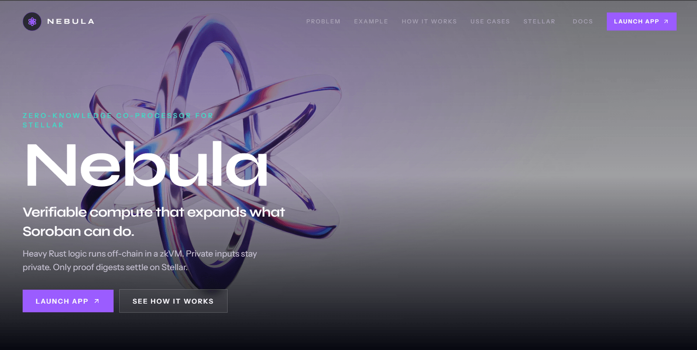
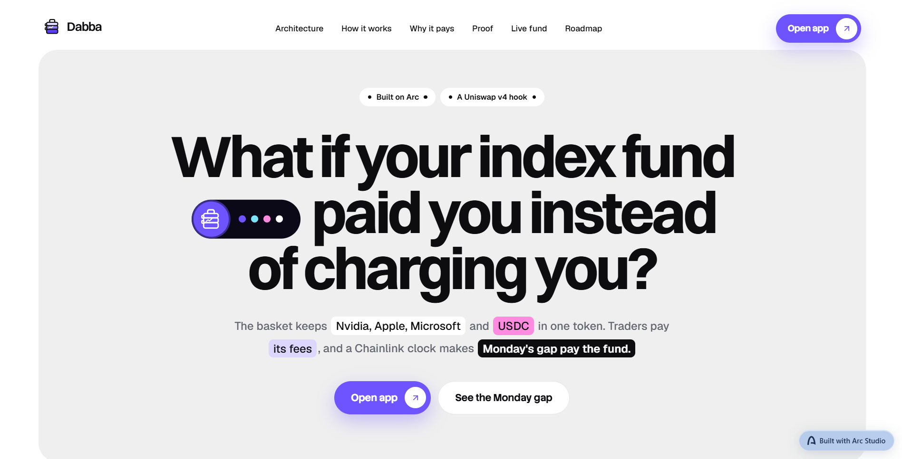
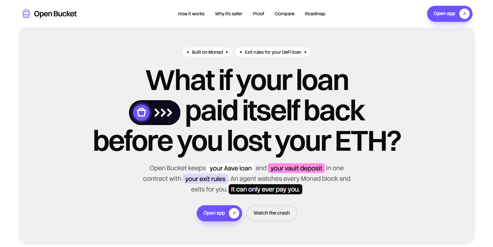

# Akil Ayman

**AI Engineer · Web3 Developer · Stellar Ambassador** — final-year B.Tech in Artificial Intelligence & Machine Learning at Srinivas University, Kerala, India.

I build intelligent AI systems, autonomous agents, and verifiable Web3 infrastructure. From AI-native products to zero-knowledge applications, I turn ideas into working software.

---

### Recognition

- **Winner — Stellar BuildStation Hackathon, Kozhikode.** Won with [Nebula](https://github.com/akilaymaan/nebula_stellar), a zero-knowledge verifiable compute layer for Stellar.
- **Arc Special Mention — ETHGlobal Mumbai.** [Dabba](https://github.com/akilaymaan/Tiffin-Fi) was one of five special mentions Arc named among the 89 teams that built on Arc. [Arc's announcement ↗](https://x.com/arc/status/2120592401853276396) · [ETHGlobal showcase ↗](https://ethglobal.com/showcase/dabba-24kbh)
- **Stellar Ambassador.** Selected as an Ambassador for the Stellar ecosystem — developer awareness, ecosystem promotion, and community engagement.

---

### Now

- **Ambassador, Stellar Blockchain** — promoting the Stellar ecosystem, its developer tools, and opportunities to students, builders, and Web3 communities.
- **Co-Founder & AI Engineer at [EVRA](https://evra.world)** — an AI-native creator–brand partnership platform: AI-agent workflows for creator discovery, brand matching, deal coordination, and human-approved negotiation.
- **Founder & engineer at ObsiLoom** — an AI automation agency building custom agents and workflow automation for businesses.
- **Shipping open-source tools** — most recently [Volo](https://github.com/akilaymaan/volo) and [Deadlock Zero](https://github.com/akilaymaan/deadlock-zero).

---

### Featured projects

**[Nebula](https://github.com/akilaymaan/nebula_stellar)** — Verifiable compute layer for Stellar. Heavy workloads run off-chain in a RISC Zero zkVM, and their proofs are verified on-chain by a Soroban contract. I built the off-chain compute pipeline, the proof workflows and prover/verifier interfaces, Soroban verification, persistent job and event records, and live job-status updates. Stellar BuildStation winner. `Rust` `Axum` `PostgreSQL` `RISC Zero` `Soroban` · [Live ↗](https://nebula-stellar-nine.vercel.app)

**[Dabba](https://github.com/akilaymaan/Tiffin-Fi)** — Stock-basket trading protocol built at ETHGlobal Mumbai with [@fahmmin](https://github.com/fahmmin). One token holds NVIDIA, Apple, Microsoft, and USDC; a single Uniswap v4 hook runs every pair against one shared reserve, with dynamic swap fees and Chainlink CRE price and market-hours data — so trading fees stay in the basket. Arc Special Mention. `Solidity` `Uniswap v4` `Chainlink CRE` `Arc` · [Live ↗](https://dabbafi.vercel.app)

**[OpenBucket](https://github.com/akilaymaan/open-bucket)** — Automated DeFi loan-exit protocol on Monad, built with [@fahmmin](https://github.com/fahmmin) for the Monad Blitz Hackathon (Monad Foundation) during Devcon Mumbai. Your Aave loan and vault deposit live in one user-owned contract with health-factor and deadline exit rules; a keeper watches every Monad block and exits for you — it can repay and return collateral, but never redirect funds. Tested with unit, Aave V3 mainnet-fork, keeper, and MetaMask end-to-end suites. `Smart Contracts` `Aave V3` `Monad` `Automated Keepers` · [Live ↗](https://openbucketmonad.vercel.app)

---

### More projects

**[Volo](https://github.com/akilaymaan/volo)** — AI voice interviews in English and ten Indian languages, built with [@fahmmin](https://github.com/fahmmin). Paste a job description and Claude drafts the questions; each candidate has a live voice interview — Sarvam speech-to-text, Claude deciding whether to follow up, move on, or wrap up, Sarvam text-to-speech for the reply — and recruiters get a scored report with the recording, transcript, and audio-linked evidence. Tested with Vitest, Playwright, and CI on GitHub Actions. `Claude API` `Sarvam AI` `Next.js` `TypeScript` `PostgreSQL` · [Live ↗](https://volo-delta.vercel.app)

**[Deadlock Zero](https://github.com/akilaymaan/deadlock-zero)** — Lock-trace forensics for concurrent programs. Builds the wait-for graph, finds deadlock cycles (Tarjan SCC + Johnson's elementary cycles) and unprotected data races via vector clocks, then generates remediation guidance — canonical lock order, diffs, incident checklist — and replays the trace through a deterministic stress-test simulator. `TypeScript` `Express` `React`

**[CrowdSentry](https://github.com/akilaymaan/crowdsentry-vision)** — Real-time crowd-risk monitoring: YOLOv8 person detection, ByteTrack tracking, spatio-temporal density/flow features and an XGBoost risk scorer, served by a FastAPI + MongoDB backend and a live WebSocket dashboard. The risk model is trained on simulated pedestrian data, so treat it as a congestion-risk proxy rather than a validated safety system. `Python` `FastAPI` `YOLOv8` `XGBoost` `React`

**[HemoLink](https://github.com/akilaymaan/HemoLink)** — AI-powered blood-donor platform: location-based discovery, ML eligibility scoring, NLP health analysis with Gemini, and explainable recommendations. Built with [@fahmmin](https://github.com/fahmmin). `Python` `FastAPI` `Node.js` `MongoDB` `React`

**[DarkTalent](https://github.com/akilaymaan/darktalent)** — Privacy-preserving talent protocol on Midnight Network: private commitments and ownership proofs verify a credential without exposing what's behind it. `Midnight` `ZK proofs`

**Also:** [ColdChain Pay](https://github.com/akilaymaan/coldchain-pay) — IoT-driven Stellar payments · [ChronoLegacy](https://github.com/akilaymaan/ChronoLegacy) — Soroban dead-man's-switch vault · [Stellar Cosmic Split](https://github.com/akilaymaan/stellar-cosmic-split) — group expense splitting on Stellar · [DevTrack](https://github.com/akilaymaan/DevTrack) — multi-source dev-job aggregator · [CRM App](https://github.com/akilaymaan/crm-app) — full-stack sales CRM

---

### Stack

**AI / ML** — `LLM applications` `AI agents` `RAG` `Embeddings` `FAISS` `MCP` `NLP` `Prompt engineering` `QLoRA / Unsloth` `Ranking & scoring` `Ultralytics YOLO` `OpenCV` `XGBoost`

**Backend / Cloud** — `Python` `FastAPI` `Flask` `Node.js` `Express` `REST APIs` `PostgreSQL` `MongoDB` `Docker` `GCP` `Cloud Run` `Vertex AI` `Microservices` `CI/CD`

**Frontend** — `TypeScript` `JavaScript` `React` `Next.js` `Tailwind`

**Automation** — `n8n` `Zapier`

**Web3 / ZK** — `Rust` `Solidity` `Soroban` `Stellar` `RISC Zero` `Midnight` `Uniswap v4` `Chainlink CRE` `Aave V3` `Smart contracts` `DeFi`

---

### Experience

- **Stellar Blockchain** — Ambassador, Nov 2026–present. Developer ecosystem and community engagement.
- **[EVRA](https://evra.world)** — Co-Founder & AI Engineer, 2026–present. AI-native creator–brand partnership platform.
- **ObsiLoom** — Founder & AI Automation Engineer, 2026–present. Custom AI agents and intelligent workflows for business automation.
- **Shri Raja Ramtek FPO Ltd.** — AI Intern, Jun–Jul 2026. AI/ML tasks and data processing for agricultural and business operations.

---

### Beyond building

- **Devcon 8, Mumbai** — engaged with the global Web3 ecosystem: founders, developers, sponsors, and the teams behind the protocols and tools I build with.
- **India Blockchain Week** — networked with founders, builders, and blockchain product teams, and explored real-world blockchain applications.

---

### Education & certifications

**Srinivas University** — B.Tech in Artificial Intelligence & Machine Learning, final year.

AWS Academy Cloud Foundations · Deep Learning with TensorFlow (IBM) · IBM Watson Services & Watson Studio

---

Open to internships, collaborations, and interesting builds — [akilaymaan@gmail.com](mailto:akilaymaan@gmail.com).
